<!-- ============ $ ./perfil.sh ============ -->
<p align="center">
  
</p>

<p align="center">
  <a href="https://www.linkedin.com"></a>
  <a href="https://github.com/heavyscan?tab=repositories"></a>
  
  
  
</p>

<br/>

<!-- ============ 01. sobre_mim() ============ -->


[](https://git.io/typing-svg)

<div align="justify">

Sou **Especialista em Cibersegurança & Tech Lead (+7 anos)** com sólida experiência em monitoramento contínuo, detecção de ameaças, investigação forense digital e resposta a incidentes (**SOC / Blue Team / DFIR**). Atuo na proteção de infraestruturas críticas corporativas e ambientes **Multi-Cloud** (`AWS`, `Azure`, `GCP`, `OCI`), unindo visão estratégica de **GRC e Gestão de Vulnerabilidades** (`Tenable`) à engenharia de segurança prática.

No meu dia a dia, lidero e opero arquiteturas **SIEM** (`Splunk`, `ELK Stack`, `QRadar`, `ArcSight`) e plataformas **EDR/XDR** (`Trend Micro`, `CrowdStrike`, `SentinelOne`, `Microsoft Defender`), além de desenvolver soluções próprias de **Zero Trust**, **Sandboxes de Detonação & Engenharia Reversa** (`REA`) e **IA aplicada à Segurança Ofensiva e Defensiva**.

</div>

```diff
+ +7 anos em Cibersegurança, Blue Team, SIEM, XDR/EDR (Trend Micro) e GRC
+ Gestão de Vulnerabilidades (Tenable), Threat Hunting & Resposta a Incidentes
+ Automação de triagem de alertas (-40% no MTTR) & Cobertura 100% em SIEM Cloud
+ Arquitetura Zero Trust, Engenharia Reversa (REA) e Offensive/Defensive IA Security
- Falsos positivos e superfícies de ataque expostas sem mitigação
```

<br clear="right"/>
<br/>

<!-- ============ 02. tecnologias() ============ -->

<p align="center">
  
</p>

<table width="100%">
  <thead>
    <tr>
      <th align="left">🛡️ Domínio</th>
      <th align="left">⚙️ Ferramentas, Plataformas & Especialidades</th>
    </tr>
  </thead>
  <tbody>
    <tr>
      <td><b>SIEM & SOC</b></td>
      <td><code>Splunk</code> · <code>ELK Stack</code> · <code>IBM QRadar</code> · <code>ArcSight</code> · Correlação de Eventos & Detecção de IoCs</td>
    </tr>
    <tr>
      <td><b>EDR / XDR & Endpoint</b></td>
      <td><code>Trend Micro Vision One</code> · <code>CrowdStrike Falcon</code> · <code>SentinelOne</code> · <code>Microsoft Defender</code> · <code>ThreatLocker Zero Trust</code></td>
    </tr>
    <tr>
      <td><b>Gestão de Riscos & Vuln</b></td>
      <td><code>Tenable</code> · <code>GRC</code> · Análise de Risco · Hardening · Playbooks de Resposta a Ransomware & Incidentes</td>
    </tr>
    <tr>
      <td><b>Cloud & Rede Segura</b></td>
      <td><code>AWS Security Hub</code> · <code>Azure Defender</code> · <code>GCP</code> · <code>OCI</code> · <code>Terraform (IaC)</code> · <code>NGFW</code> · <code>WAF</code> · <code>ZTNA</code> · <code>IPS/IDS</code> · <code>VPN</code></td>
    </tr>
    <tr>
      <td><b>Análise, Forense & IA Sec</b></td>
      <td><code>REA (Reverse Engineer Anything)</code> · <code>Wireshark</code> · <code>Nmap</code> · <code>Metasploit</code> · <code>Burp Suite</code> · <code>Ghidra</code> · <code>Frida</code> · <code>LLMs Locais (Ollama)</code></td>
    </tr>
    <tr>
      <td><b>Formação & Certificações</b></td>
      <td>🎓 Graduação em Segurança da Informação · Pós-graduação em Cibersegurança · 🏆 <code>CISSP</code> · <code>CEH</code> · <code>OSCP</code></td>
    </tr>
  </tbody>
</table>

<br/>

<!-- ============ 03. projetos() ============ -->

<p align="center">
  <a href="https://github.com/heavyscan/anyrun-rea-sandbox"><picture><source media="(prefers-color-scheme: dark)" srcset="https://raw.githubusercontent.com/heavyscan/heavyscan/output/repo-1-dark.svg" /><source media="(prefers-color-scheme: light)" srcset="https://raw.githubusercontent.com/heavyscan/heavyscan/output/repo-1.svg" /></picture></a>
  <a href="https://github.com/heavyscan/threatlocker-zt"><picture><source media="(prefers-color-scheme: dark)" srcset="https://raw.githubusercontent.com/heavyscan/heavyscan/output/repo-2-dark.svg" /><source media="(prefers-color-scheme: light)" srcset="https://raw.githubusercontent.com/heavyscan/heavyscan/output/repo-2.svg" /></picture></a>
</p>
<p align="center">
  <a href="https://github.com/heavyscan/multicloud-network-security"><picture><source media="(prefers-color-scheme: dark)" srcset="https://raw.githubusercontent.com/heavyscan/heavyscan/output/repo-3-dark.svg" /><source media="(prefers-color-scheme: light)" srcset="https://raw.githubusercontent.com/heavyscan/heavyscan/output/repo-3.svg" /></picture></a>
  <a href="https://github.com/heavyscan/Guardi-o-do-GitHub"><picture><source media="(prefers-color-scheme: dark)" srcset="https://raw.githubusercontent.com/heavyscan/heavyscan/output/repo-4-dark.svg" /><source media="(prefers-color-scheme: light)" srcset="https://raw.githubusercontent.com/heavyscan/heavyscan/output/repo-4.svg" /></picture></a>
</p>
<p align="center">
  <a href="https://github.com/heavyscan/Forense-para-server-Linux"><picture><source media="(prefers-color-scheme: dark)" srcset="https://raw.githubusercontent.com/heavyscan/heavyscan/output/repo-5-dark.svg" /><source media="(prefers-color-scheme: light)" srcset="https://raw.githubusercontent.com/heavyscan/heavyscan/output/repo-5.svg" /></picture></a>
  <a href="https://github.com/heavyscan/PyHTools"><picture><source media="(prefers-color-scheme: dark)" srcset="https://raw.githubusercontent.com/heavyscan/heavyscan/output/repo-6-dark.svg" /><source media="(prefers-color-scheme: light)" srcset="https://raw.githubusercontent.com/heavyscan/heavyscan/output/repo-6.svg" /></picture></a>
</p>

<br/>

<!-- ============ 04. estatisticas() ============ -->

<p align="center">
  <picture><source media="(prefers-color-scheme: dark)" srcset="https://raw.githubusercontent.com/heavyscan/heavyscan/output/stats-dark.svg" /><source media="(prefers-color-scheme: light)" srcset="https://raw.githubusercontent.com/heavyscan/heavyscan/output/stats.svg" /></picture>
  <picture><source media="(prefers-color-scheme: dark)" srcset="https://raw.githubusercontent.com/heavyscan/heavyscan/output/langs-dark.svg" /><source media="(prefers-color-scheme: light)" srcset="https://raw.githubusercontent.com/heavyscan/heavyscan/output/langs.svg" /></picture>
</p>

<p align="center">
  
</p>

<br/>

<!-- ============ 05. contribuicoes() — compilador de contribuições ============ -->

<picture>
  <source media="(prefers-color-scheme: dark)" srcset="https://raw.githubusercontent.com/heavyscan/heavyscan/output/code-contribution-graph-dark.svg" />
  <source media="(prefers-color-scheme: light)" srcset="https://raw.githubusercontent.com/heavyscan/heavyscan/output/code-contribution-graph.svg" />
  
</picture>

<!-- ============ exit ============ -->
<p align="center">
  
</p>
